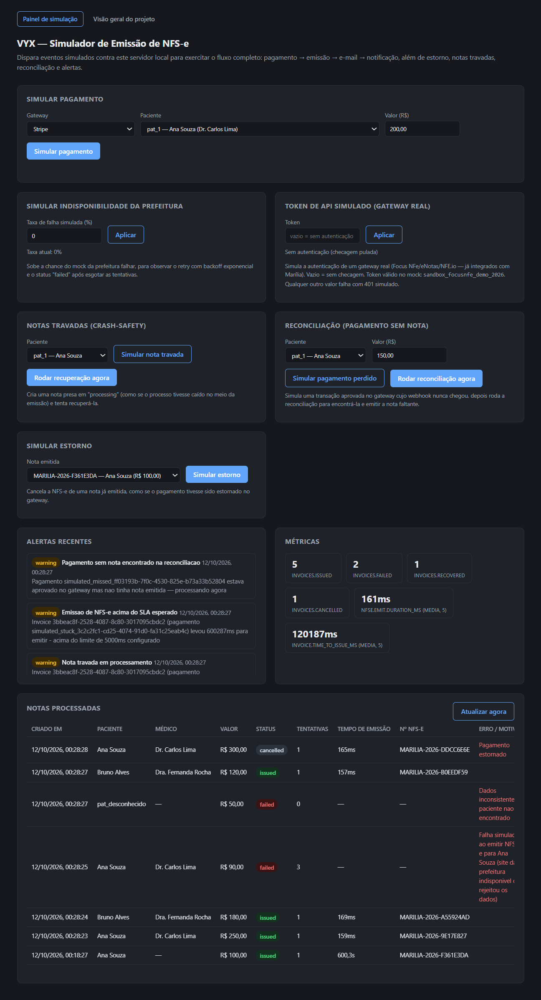

# Agente de emissão de Notas Fiscais — VYX

[](https://github.com/victor-germano/agente-emissao-nfse/actions/workflows/ci.yml)

Protótipo do agente que implementa o fluxo **TO-BE** descrito em
`Processo de Emissão de Notas Fiscais — VYX`: recebe o evento de
pagamento, associa automaticamente paciente + médico, emite a NFS-e junto
à Prefeitura de Marília, envia o PDF por e-mail e notifica o App.

## Telas

Painel local de simulação, com alertas, métricas e as notas processadas em cada cenário (pagamento normal, prefeitura instável, nota travada, pagamento perdido e estorno):



A página de visão geral do projeto está em [`docs/screenshots/visao-geral.png`](docs/screenshots/visao-geral.png).

## Por que a maioria das bordas é mockada (mas a persistência é real)

Este é um teste técnico, sem credenciais reais de Stripe/Prefeitura de
Marília. Em vez de simular essas integrações com dados falsos, o sistema
foi desenhado com **interfaces (ports) explícitas** em cada ponto de
integração externa (`NFSeClient`, `EmailSender`, `AppNotifier`,
`PatientDoctorRepository`, `InvoiceRepository`). Trocar uma implementação
mock por uma real é implementar a interface e injetar em `src/index.ts` —
nenhuma outra parte do sistema muda. Essa é a decisão de arquitetura mais
importante do projeto.

A persistência é a exceção: existe um **projeto Supabase real** criado
para este agente (Postgres gerenciado, schema já aplicado — tabelas
`patients`, `doctors`, `consultations`, `invoices`, `invoice_audit_log`,
com RLS habilitado). `SupabaseInvoiceRepository`,
`SupabasePatientDoctorRepository` e `SupabaseAuditTrail` são
implementações completas, não placeholders. O app detecta em runtime se
`SUPABASE_URL` + `SUPABASE_SERVICE_ROLE_KEY` estão configuradas
(`src/index.ts`) e usa Postgres de verdade; caso contrário, cai para as
implementações in-memory — útil para rodar o painel local sem depender de
rede. Ver "Ativando a persistência real" abaixo.

## Fluxo implementado (TO-BE)

```
POST /webhooks/stripe            POST /webhooks/gateway2 (Pix/parcelado)
        │                                     │
        └───────────────┬─────────────────────┘
                         ▼
              normaliza para PaymentEvent
                         ▼
          InvoiceEmissionService.processPayment
                         │
        ┌────────────────┼─────────────────────┐
        ▼                ▼                     ▼
  idempotência    associa paciente+médico   cria Invoice "processing"
 (por externalId)  (PatientDoctorRepository)
                         │
                         ▼
       NFSeClient.emit()  com retry/backoff exponencial
                         │
              ┌──────────┴──────────┐
              ▼                     ▼
         sucesso: "issued"     falhas esgotadas: "failed"
              │                (lastError registrado p/ auditoria)
              ▼
     EmailSender + AppNotifier (falhas aqui não revertem a nota)
```

## Mapeamento com o documento

| Etapa do TO-BE | Implementação |
|---|---|
| 1-2. Stripe / 2º gateway → App | `POST /webhooks/stripe` e `POST /webhooks/gateway2`, cada um com seu parser (`src/adapters/paymentGateway`) normalizando para `PaymentEvent` |
| 3. Associação automática médico+valor | `PatientDoctorRepository.findLastDoctorForPatient` — real via Supabase (tabela `consultations`) quando configurado, senão in-memory |
| 4. Disparo da emissão | `InvoiceEmissionService` chama `NFSeClient.emit` |
| 4 (integração c/ prefeitura) | `NFSeClient` — interface; `PrefeituraMariliaMockClient` simula latência e falhas |
| 5. Nota (PDF) retorna e reflete no sistema | `Invoice.pdfUrl` / `Invoice.nfseNumber` persistidos via `InvoiceRepository` |
| 6. E-mail automático ao paciente | `EmailSender` (`ConsoleEmailSender` no protótipo) |
| 7. Notificação webhook "nota disponível" | `AppNotifier` (`HttpAppNotifier`, faz POST se `APP_NOTIFICATION_WEBHOOK_URL` estiver configurada) |
| 8. Financeiro sai da operação manual | Não há nenhum passo manual no fluxo feliz; falhas ficam visíveis em `GET /invoices/failed` para intervenção pontual |

## Pontos em aberto do documento (seção 3) — avaliação ponto a ponto

O documento lista 5 perguntas explícitas para o dev definir/testar. Status de cada uma:

1. **"Arquitetura exata da integração Stripe → n8n → Supabase → App"** —
   ✅ decidida e implementada, mas com uma escolha deliberada: o app recebe
   os webhooks **diretamente** (`POST /webhooks/stripe`/`gateway2`), sem
   passar pelo n8n. O n8n é ótimo para orquestração visual/low-code, mas
   para lógica com idempotência atômica, retry com estado e transações teria
   virado um gargalo de testabilidade — por isso a lógica foi trazida para
   código versionado e testado, com Supabase como a peça de persistência
   real do desenho original. Isso é uma decisão de arquitetura para
   discutir na entrevista, não um espaço em branco.
2. **"Forma de integração com o site da Prefeitura de Marília: API oficial
   ou RPA/navegador headless?"** — ✅ **existe API oficial, direta, sem
   necessidade de RPA** — isso corrige uma suposição de uma rodada anterior
   desta pesquisa. Baixei e li o manual técnico oficial da própria Marília
   ([`marilia.sigiss.com.br/marilia/download/manual webservice 2.0
   marilia.pdf`](https://marilia.sigiss.com.br/marilia/download/manual%20webservice%202.0%20marilia.pdf)):
   é um webservice **SOAP/XML** em
   `https://marilia.sigiss.com.br/marilia/ws/sigiss_ws.php?wsdl`, com métodos
   `GerarNota`, `CancelarNota`, `ConsultarNotaValida` e
   `ConsultarNotaPrestador`. A autenticação **não é certificado digital** —
   é CCM + CNPJ + senha do prestador, enviados como parâmetros dentro do
   próprio payload SOAP; o certificado digital é opcional e serve só para
   assinar o XML da nota já emitida, não para autenticar a chamada. A API já
   tem um campo nativo de idempotência (`id_sis_legado`) que impede emitir a
   mesma nota duas vezes — o design deste protótipo (idempotência por
   `paymentExternalId`) se encaixaria nele quase 1:1.

   Duas ressalvas que mudam a recomendação prática: **(a)** esse manual é de
   **2012** (versão 1.9); **(b)** a Lei Complementar 214/2025 obriga todo
   município a operar no Ambiente de Dados Nacional da NFS-e desde
   01/01/2026, e a própria Marília [passou por instabilidade recente
   adaptando o sistema local a esse layout
   nacional](https://marilianoticia.com.br/sistema-da-nota-fiscal-de-servicos-passa-por-atualizacao-e-pode-ter-falhas-em-marilia/).
   Ou seja: a API SOAP existe e é real, mas construir direto contra uma
   documentação de 13 anos atrás, numa cidade em transição de padrão fiscal
   agora, é assumir o risco de manutenção de acompanhar essa mudança sozinho
   — inclusive re-homologar acesso, já que não há ambiente de
   homologação/sandbox documentado nesse manual (só produção).

   Por isso, **mantenho a recomendação prática de usar um gateway** — não
   porque a API direta não exista, mas porque um gateway já absorve o custo
   de acompanhar essa transição nacional. Comparei os três com preço e
   sandbox **verificados agora, não estimados**:

   | | **Focus NFe** | **eNotas** | **NFE.io** |
   |---|---|---|---|
   | Suporta Marília/Sigiss explicitamente | ✅ [confirmado](https://focusnfe.com.br/blog/como-emitir-nota-fiscal-de-servico-nfse-em-marilia-sp/) (mapeamento de campos Sigiss, NBS, retenção PIS/COFINS/CSLL) | Genérico (sem página dedicada a Marília encontrada) | ✅ [página dedicada a Marília](https://nfe.io/docs/prefeituras-integradas/sao-paulo/marilia-sp-3529005/) |
   | Preço de entrada | [R$89,90/mês](https://focusnfe.com.br/precos/) (Solo, 1 CNPJ, 100 notas, +R$0,10/nota extra) | [R$137/mês](https://enotass.com.br/notas) (Básico, 50 notas) | ~R$119/mês (120 docs, +R$0,75/doc, taxa de setup + contrato mínimo de 3 meses) |
   | Sandbox/homologação | ✅ Gratuito e **ilimitado**, sem cartão, URL própria (`homologacao.focusnfe.com.br`) | Existe (Plus/Pro), sandbox citado na doc oficial | Não confirmei detalhes concretos do sandbox na pesquisa — só a existência |
   | Autenticação (verificado na doc oficial) | **HTTP Basic Auth**: token da empresa como usuário, senha em branco ([doc.focusnfe.com.br/reference/autenticacao](https://doc.focusnfe.com.br/reference/autenticacao.md)) | REST API com chave própria (Plus/Pro) | API REST com Swagger, SDKs oficiais |
   | Contrato mínimo | Nenhum encontrado | Nenhum encontrado | 3 meses — trava de saída |

   **Recomendação, agora com base verificada**: **Focus NFe** — é o único
   dos três com suporte a Marília confirmado por escrito pelo próprio
   provedor, tem o trial mais barato e sem trava de contrato, e a
   autenticação (HTTP Basic Auth, token como usuário) é simples de
   implementar. `NFSeClient` isola essa decisão — o adapter real seria uma
   classe `FocusNfeClient implements NFSeClient` chamando
   `homologacao.focusnfe.com.br` (testes) ou `api.focusnfe.com.br`
   (produção). `PrefeituraMariliaMockClient` já simula esse padrão de
   autenticação (ver `NFSE_API_TOKEN` abaixo) — pronto para trocar assim que
   houver uma credencial real de homologação.
3. **"Regras de fallback/erro na emissão"** — ✅ `withRetry` com backoff
   exponencial, `status: "failed"` + `lastError` quando esgota tentativas,
   alertas ativos (`AlertNotifier`), recuperação de notas travadas
   (`recoverStuckInvoices`) e trilha de auditoria de cada falha.
4. **"Como e quando será feita a automação do segundo gateway (Pix/parcelado)"**
   — ⚠️ parcial, e o próprio documento já classifica isso como "próximo
   passo futuro, fora do escopo imediato". O endpoint/schema
   (`POST /webhooks/gateway2`) e o pipeline completo já existem; falta só a
   integração real com o gateway de verdade quando ele existir.
5. **"Formato de retentativa e alertas em caso de falha"** — ✅ backoff
   exponencial configurável, `AlertNotifier` disparando em toda falha
   (emissão, dados inconsistentes, estorno desconhecido, reconciliação),
   consultável via `GET /alerts`, mais métricas (`GET /metrics`) para saúde
   geral.

Resumindo: dos 5 pontos, 4 estão resolvidos (3 e 5 por completo; 1 como
decisão de arquitetura explícita e defensável; 2 com pesquisa verificada e
uma recomendação concreta, mesmo sem credencial real em mãos), e 1 é parcial
por decisão explícita do próprio documento (4). Nenhum ponto ficou sem
avanço real.

## Além do documento: fechando lacunas de uma automação completa

O documento original cobre o caminho feliz e lista pontos em aberto, mas
"financeiro sai completamente da operação manual" só é verdade se falhas
forem visíveis e o sistema se recuperar sozinho de problemas comuns. Cinco
adições cobrem isso:

1. **Alertas ativos em falha** (`AlertNotifier`, `src/adapters/alerting`) —
   toda falha de emissão, dado inconsistente, estorno de pagamento
   desconhecido ou achado da reconciliação dispara um alerta, hoje guardado
   em memória e exposto via `GET /alerts` (consumido pelo painel visual). Em
   produção, troca-se `InMemoryAlertNotifier` por uma implementação que
   posta num webhook do Slack/PagerDuty — mesma interface.
2. **Recuperação de notas travadas** (`InvoiceEmissionService.recoverStuckInvoices`)
   — varre invoices presas em `"processing"` (ex: o processo caiu no meio da
   emissão) e tenta finalizá-las. Roda a cada `RECOVERY_SWEEP_INTERVAL_MS` e
   também sob demanda via `POST /debug/recover-stuck`.
3. **Verificação de assinatura do webhook Stripe** (`src/adapters/paymentGateway/stripeSignature.ts`)
   — reimplementa o esquema real do Stripe (`t=<timestamp>,v1=<hmac>`), não
   um placeholder. Ativa automaticamente quando `STRIPE_WEBHOOK_SECRET` é
   configurada; sem ela, a checagem é pulada (conveniente para o painel
   local). O segundo gateway tem uma checagem equivalente mais simples via
   header `x-gateway2-secret` + `GATEWAY2_WEBHOOK_SECRET`.
4. **Reconciliação Stripe × notas emitidas** (`ReconciliationService`) — roda
   periodicamente (`RECONCILIATION_INTERVAL_MS`) comparando os pagamentos
   aprovados no gateway com as invoices existentes, para pegar casos em que
   o webhook nunca chegou. Também disparável via `POST /reconciliation/run`.
5. **Cancelamento por estorno** — um evento `charge.refunded` do Stripe
   localiza a invoice pelo `payment_intent` original, cancela a NFS-e já
   emitida (`NFSeClient.cancel`) e avisa o paciente por e-mail. Sem isso, um
   reembolso deixaria uma nota fiscal órfã no sistema.
6. **Persistência real (Supabase)** — as adições de resiliência acima (1 e
   2, principalmente) só valem a pena de verdade quando o estado sobrevive
   a um restart/crash do processo. `SupabaseInvoiceRepository`,
   `SupabasePatientDoctorRepository` e `SupabaseAuditTrail`
   (`src/repositories`, `src/adapters/audit`) implementam as mesmas
   interfaces contra um projeto Supabase real. Detalhes em "Ativando a
   persistência real".
7. **Corrida na idempotência** — o `findOrCreate` original (checar
   existência, depois criar) tinha uma janela real de corrida: dois
   webhooks do mesmo pagamento chegando quase simultaneamente (comum em
   retries de gateway) podiam ambos passar pela checagem antes de qualquer
   um persistir, gerando duas notas. `InvoiceRepository.findOrCreate`
   agora resolve isso de duas formas: em memória, via um mapa de
   "criações em andamento" que serializa chamadas concorrentes para a
   mesma chave (`src/repositories/InvoiceRepository.ts`); no Supabase, via
   `INSERT` + constraint `UNIQUE(payment_external_id)` no banco — a
   atomicidade real vem do Postgres, não de um mutex simulado. Coberto por
   teste de concorrência (`Promise.all` com o mesmo evento).
8. **Trilha de auditoria imutável** (`AuditTrail`, `src/adapters/audit`) —
   como isso lida com dados de saúde e documentos fiscais, cada transição
   de estado da nota (criada, emitida, falhou, cancelada, recuperada) fica
   registrada num log append-only, separado do registro mutável da
   invoice — relevante para rastreabilidade/compliance. Consultável via
   `GET /invoices/:id/audit`.
9. **Ack rápido no webhook** (`InvoiceEmissionService.acceptPaymentAsync`)
   — antes, `POST /webhooks/stripe` só respondia depois que a emissão
   (com todas as retentativas, podendo levar segundos) terminava. Isso
   arrisca o Stripe considerar a entrega expirada e reenviar o mesmo
   evento. Agora o handler resolve idempotência + associação
   paciente/médico (rápido) e responde `202` com a nota ainda em
   `"processing"`, enquanto a emissão continua em background — o
   consumidor deve consultar `GET /invoices/:id` ou aguardar a notificação
   do App para saber o resultado final. `processPayment` (síncrono)
   continua existindo para quem precisa do resultado final na hora (ex:
   reconciliação, recuperação de travadas, testes).
10. **Métricas básicas** (`Metrics`, `src/adapters/metrics`) — contadores
    de notas emitidas/falhas/canceladas/recuperadas e a duração média da
    emissão, expostos via `GET /metrics`. Sem isso, a saúde da automação só
    é percebida quando um alerta de falha dispara.
11. **Autenticação nos endpoints de operação** (`requireApiKey`,
    `src/api/requireApiKey.ts`) — antes, `/invoices`, `/alerts`, `/metrics`
    e todos os `/debug/*` estavam completamente abertos: qualquer um que
    alcançasse o servidor lia dados de paciente (CPF, e-mail) ou disparava
    simulações. Configurando `ADMIN_API_KEY`, essas rotas passam a exigir
    `Authorization: Bearer <chave>` (comparação em tempo constante). Os
    webhooks de pagamento e `/health` continuam públicos (têm sua própria
    verificação de origem). Sem a variável configurada, nada muda —
    permanece aberto para uso local/demo.
12. **Rotas de debug fora de produção** (`enableDebugRoutes`) — os
    endpoints `/debug/*` (simular nota travada, pagamento perdido, etc.) só
    existem para demonstrar/testar os mecanismos de resiliência; não fazem
    sentido expostos numa API de produção. Com `NODE_ENV=production`, essas
    rotas nem são registradas (404), independente de autenticação.
13. **Logging estruturado** (`src/lib/logger.ts`) — trocou `console.log`
    solto por uma linha JSON por evento (`{level, message, context,
    timestamp}`) no serviço principal e no startup/shutdown, para ser
    consumível por uma ferramenta real de observabilidade (Datadog, ELK,
    CloudWatch) em vez de texto livre.
14. **Graceful shutdown** — antes, um `SIGTERM`/`SIGINT` (deploy, restart)
    cortava qualquer emissão em background no meio. Agora o processo para
    de aceitar conexões novas, espera as emissões em voo terminarem (com
    timeout de 5s) e só então encerra (`InvoiceEmissionService.waitForIdle`).
15. **Health check real** (`GET /health`) — antes sempre respondia `ok`
    incondicionalmente. Com Supabase configurado, agora testa
    conectividade de verdade (`select` leve na tabela `patients`) e
    responde `503` se o banco estiver inacessível; em memória, responde
    `ok` normalmente.
16. **Token de API simulado para a Prefeitura** (`NFSE_API_TOKEN`,
    `PrefeituraMariliaMockClient`) — ensaia o padrão de autenticação de um
    gateway real (Focus NFe/eNotas/NFE.io, ver ponto 2 acima). Vazio =
    checagem pulada (compatível com o comportamento anterior); configurado,
    exige o valor `sandbox_focusnfe_demo_2026` — qualquer outro falha com
    `401` simulado. Esse erro é marcado como **não-retryable**: uma
    credencial errada não vira certa sozinha entre uma tentativa e outra,
    então `withRetry` para imediatamente em vez de insistir 3x à toa (bug
    real que apareceu ao testar isso e foi corrigido — ver `src/core/retry.ts`).

## Rodando localmente

```bash
npm install
cp .env.example .env
npm run dev        # http://localhost:3000
```

### Ativando a persistência real (Supabase)

Existe um projeto Supabase já criado e com o schema aplicado
(`vyx-nf-agent`, plano gratuito). Para o app usar Postgres de verdade em
vez de in-memory:

1. Abra https://supabase.com/dashboard/project/nlyiesaskjvwiwdgscxl/settings/api-keys
2. Copie o `service_role` secret key
3. Cole em `SUPABASE_SERVICE_ROLE_KEY` no seu `.env` (`SUPABASE_URL` já vem
   preenchida no `.env.example`)
4. Reinicie o servidor — o log de startup mostra qual modo está ativo
   (`Persistencia real via Supabase` ou `Persistencia in-memory`)

O `service_role` key **nunca** é obtido por automação/MCP — é um segredo
que só o dono da conta pode copiar do dashboard. Sem ele preenchido, tudo
funciona normalmente em memória (comportamento padrão, inclusive nos
testes automatizados).

### Painel visual

Abrindo `http://localhost:3000` no navegador (servido pelo próprio Express a
partir de `public/index.html`, sem build/framework) você tem: formulário
para simular pagamentos (Stripe ou segundo gateway); controle para forçar a
taxa de falha do mock da Prefeitura; simulação de nota travada + botão de
recuperação; simulação de pagamento perdido + botão de reconciliação;
simulação de estorno sobre uma nota já emitida; feed de alertas recentes;
painel de métricas; e a tabela de notas processadas (com link "ver" por
linha para a trilha de auditoria) — tudo atualizado a cada 2s. Com
persistência in-memory, reiniciar o servidor limpa tudo; com Supabase
configurado, os dados sobrevivem a restarts.

Simular um pagamento Stripe via curl (alternativa ao painel):

```bash
curl -X POST http://localhost:3000/webhooks/stripe \
  -H 'content-type: application/json' \
  -d '{
    "id": "evt_1",
    "type": "payment_intent.succeeded",
    "data": { "object": {
      "id": "pi_123", "amount": 20000, "currency": "brl",
      "metadata": { "patient_id": "pat_1" }
    }}
  }'
```

Simular um pagamento Pix (segundo gateway):

```bash
curl -X POST http://localhost:3000/webhooks/gateway2 \
  -H 'content-type: application/json' \
  -d '{
    "transactionId": "pix_1", "method": "pix",
    "patientId": "pat_2", "amountCents": 15000,
    "paidAt": "2026-07-05T12:00:00Z"
  }'
```

Consultar: `GET /invoices`, `GET /invoices/:id`, `GET /invoices/failed`,
`GET /invoices/:id/audit`, `GET /alerts`, `GET /metrics`.

Outros endpoints de debug/operação: `POST /debug/simulate-stuck-invoice`,
`POST /debug/recover-stuck`, `POST /debug/simulate-missed-payment`,
`POST /reconciliation/run`, `GET`/`POST /debug/nfse-api-token` (ver ponto 16).

Note que `POST /webhooks/stripe` e `POST /webhooks/gateway2` respondem
`202` com a invoice em `status: "processing"` quase imediatamente — a
emissão roda em background (ver item 9 acima). Consulte `GET /invoices/:id`
logo em seguida para ver o resultado final (`issued`/`failed`).

Para testar o cenário de falha/retry, ajuste `NFSE_MOCK_FAILURE_RATE` no
`.env` (ex: `0.5`) e observe os `attempts` na resposta.

Pacientes/médicos de exemplo (seed in-memory, ver
`src/repositories/PatientDoctorRepository.ts`): `pat_1` (Ana Souza / Dr.
Carlos Lima) e `pat_2` (Bruno Alves / Dra. Fernanda Rocha).

Se `ADMIN_API_KEY` estiver configurada, as consultas acima (exceto
`/webhooks/*` e `/health`) exigem o header
`Authorization: Bearer <ADMIN_API_KEY>` — inclusive o painel visual em
`public/index.html` deixa de funcionar sem ele, já que a página não tem
como saber a chave. Para produção real, o certo seria um dashboard interno
com seu próprio login, não a página estática de demo.

## Simulação automática completa

`scripts/demo.sh` dispara, em sequência, contra o servidor rodando: um
pagamento Stripe normal, um Pix pelo segundo gateway, um cenário de
prefeitura instável (retry), um pagamento com paciente inexistente (dado
inconsistente), uma nota travada + recuperação, um pagamento perdido +
reconciliação, e um pagamento seguido de estorno — depois imprime o estado
final de `/invoices`, `/alerts` e `/metrics`. É a demonstração de ponta a
ponta do fluxo TO-BE completo, sem intervenção manual:

```bash
npm run dev              # terminal 1
bash scripts/demo.sh      # terminal 2
```

## Testes

```bash
npm run typecheck
npm test
```

Cobrem: retry/backoff, associação automática médico+paciente, idempotência
(incluindo concorrência real via `Promise.all` no mesmo pagamento), emissão
com falha transitória seguida de sucesso, falha após esgotar tentativas,
dados inconsistentes, os dois webhooks HTTP fim a fim (com o ack
desacoplado — resposta rápida em `processing`, resultado final via
polling), recuperação de notas travadas, estorno/cancelamento,
reconciliação, verificação de assinatura do Stripe (assinatura válida,
adulterada, segredo errado, timestamp expirado), trilha de auditoria,
métricas, autenticação por API key nos endpoints de operação, rotas de
debug desabilitadas, health check customizado, token de API simulado da
prefeitura (válido/inválido/ausente) e erros não-retryable interrompendo o
retry imediatamente com o número real de tentativas registrado. Rodam
sempre contra as implementações in-memory — não tocam o Supabase real.

## Como plugar as integrações reais

- **Supabase**: já implementado e com projeto real criado — só falta
  preencher `SUPABASE_SERVICE_ROLE_KEY` (ver "Ativando a persistência
  real").
- **Stripe real**: a verificação de assinatura já está implementada
  (`verifyStripeSignature`) — basta configurar `STRIPE_WEBHOOK_SECRET` com o
  segredo real do endpoint.
- **Prefeitura de Marília real**: nova implementação de `NFSeClient` — API
  oficial (se existir) ou automação via Playwright contra o portal web,
  mantendo a mesma assinatura `emit(request): Promise<NFSeEmissionResult>`.
- **E-mail real**: trocar `ConsoleEmailSender` por um provedor
  (SES/SendGrid/SMTP) implementando `EmailSender`.
- **Alertas reais**: trocar/complementar `InMemoryAlertNotifier` por uma
  implementação que posta num webhook do Slack/PagerDuty — mesma interface
  `AlertNotifier`.

## Não incluído (fora do escopo deste protótipo)

- Automação do segundo gateway de pagamento em produção (o endpoint já
  existe; falta a integração real, item citado no documento como "próximo
  passo futuro").
- Reconciliação real com a API do Stripe — `ReconciliationGateway` é mockado
  (lista o que foi injetado via `/debug/simulate-missed-payment`); em
  produção, implementaria `listRecentSuccessfulPayments` consultando
  `stripe.charges.list` ou similar.
- Ack rápido também no cancelamento por estorno (`processRefund` continua
  síncrono) — menos crítico porque é um único `cancel`, não uma cadeia de
  retentativas de emissão.
- Métricas em formato Prometheus/OpenTelemetry — hoje é um JSON simples
  (`GET /metrics`); em produção trocaria `InMemoryMetrics` por um client
  real (ex: `prom-client`), mesma interface.
- Rate limiting nos webhooks públicos — nada impede hoje um volume anormal
  de requisições em `/webhooks/*`.
- Um dashboard interno de verdade para operação (com login próprio) — o
  painel em `public/index.html` é deliberadamente uma ferramenta de
  demonstração/teste local, não uma interface para o time financeiro.

## Licença

MIT. Ver [LICENSE](LICENSE).
